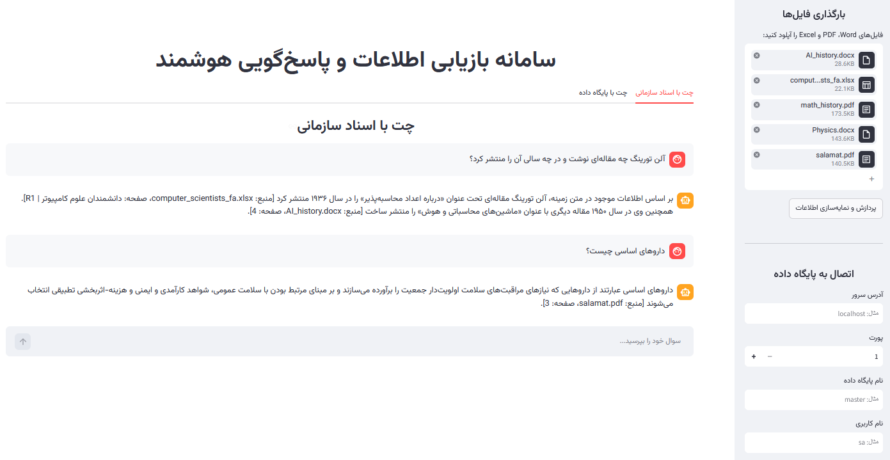
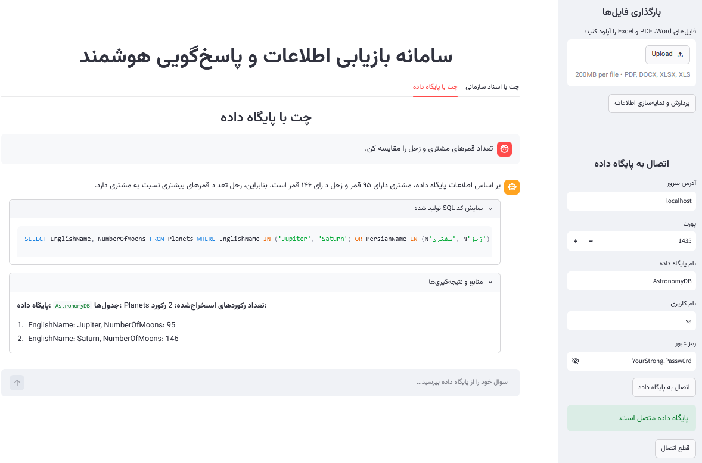
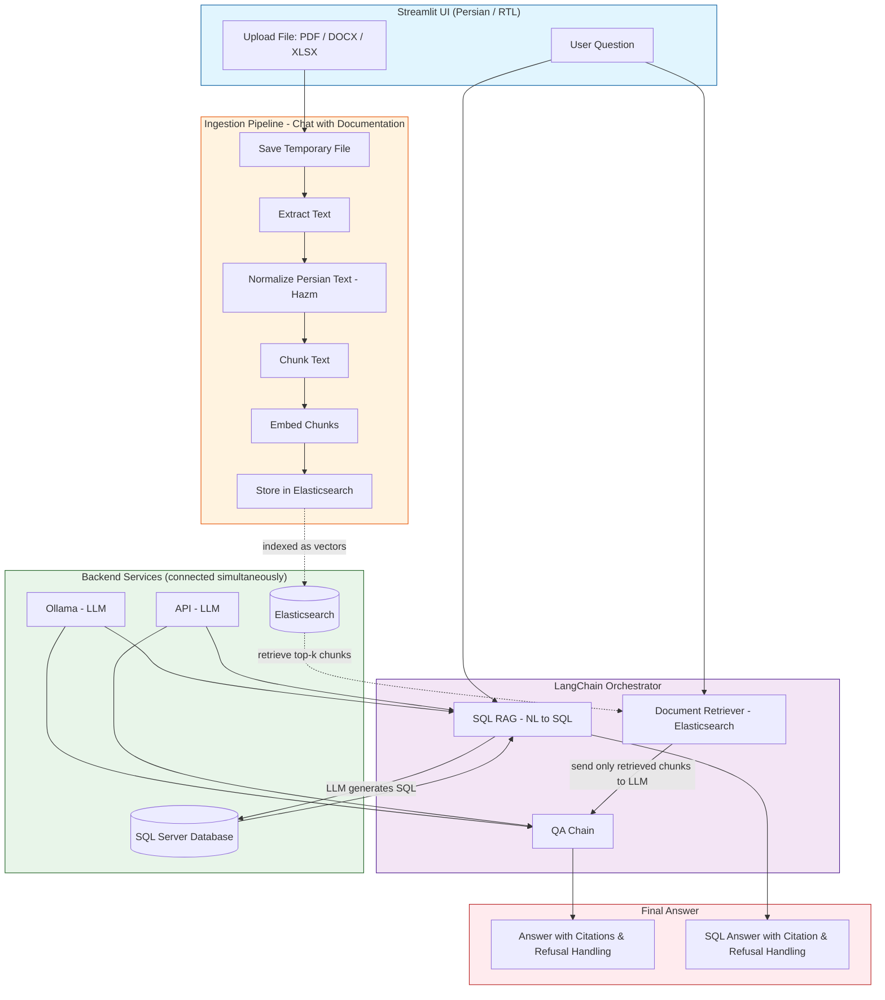

# Persian RAG — Information Retrieval and Intelligent Answering System 

A Retrieval-Augmented Generation (RAG) system in **Persian (Farsi)** that lets you chat with your documents **and** your SQL Server database through a single Streamlit interface. It supports local offline models (Ollama), hybrid setups, and fully online Google Gemini models, with citations and refusal handling for document answers.

## 📖 Introduction

**Persian RAG** is an organizational information-retrieval and question-answering system built for Persian-language content. It provides two main capabilities:

1. **Chat with Documentation** — upload PDF, Word (DOCX), or Excel files; the system extracts and normalizes the text, chunks it, embeds the chunks, and stores them in Elasticsearch. At question time, only the most relevant retrieved chunks are sent to the LLM, which answers in Persian with per-source citations and handles out-of-scope questions with a refusal message.
2. **Chat with Database** — ask questions about a SQL Server database in natural language. The LLM generates a read-only SQL query, the query is executed against SQL Server, and the LLM produces a final answer with a citation (database name, tables used, and returned records).

The frontend is a **Streamlit** app with a full **RTL (right-to-left)** Persian layout using the Vazirmatn font.

## 🖼️ Demo


---


## 🏗️ Overall System Architecture

The application can connect to **Ollama** (local LLM/embedding), **an external API** (remote LLM/embedding such as Gemini), **Elasticsearch** (vector document store), and **SQL Server** (relational database) at the same time.

**The active stack is**: Embeddings: "gemini-embedding-2" and LLM: "gemini-3.5-flash-lite"

### Architecture Diagram



### Key Architectural Notes

| Component                                          | Role                                                                                                                                                                                                                          |
| -------------------------------------------------- | ----------------------------------------------------------------------------------------------------------------------------------------------------------------------------------------------------------------------------- |
| **User question**                                  | Entered in Persian via the Streamlit chat input (Document tab or Database tab).                                                                                                                                               |
| **Streamlit UI**                                   | Single-page RTL app; sidebar for file upload/indexing and SQL Server connection; two tabs for documentation Q&A and database Q&A.                                                                                             |
| **Ingestion pipeline**                             | Uploaded file → saved as a temporary file → text extraction → Persian normalization → chunking → embedding → storage in Elasticsearch. Temporary files are deleted after indexing.                                            |
| **LangChain Orchestrator**                         | Wraps the retriever, QA chain, and SQL RAG logic; selects the configured LLM and embedding model.                                                                                                                             |
| **Document Retriever (Elasticsearch)**             | Dense vector similarity search over indexed chunks; returns the top-_k_ most relevant chunks only.                                                                                                                            |
| **SQL Server Database**                            | Stores structured data (e.g. `AstronomyDB`); queried with read-only SQL generated by the LLM.                                                                                                                                 |
| **Final Answer with Citations & Refusal Handling** | Document answers cite the source file and page (`[منبع: نام فایل، صفحه]`); if the answer is not in the context, a fixed Persian refusal message is returned. Database answers cite the database, tables, and records used. |

### Flow 1 — Chat with Documentation

```
Upload file → Save temporary file → Extract text → Normalize Persian text → Chunk text → Embed chunks → Store in Elasticsearch
                                                              ↓
At question time: Retrieve chunks → Send only retrieved chunks to LLM → Answer with citations / refusal
```

### Flow 2 — Chat with Database

```
User question → LLM generates SQL → Execute SQL → LLM answers with citation
```

### How the Project Works (end to end)

1. Start Elasticsearch and SQL Server with Docker Compose.
2. (Database only) Create the `AstronomyDB` database and tables by running `data/dataGeneration/AstronomyDB.sql` in SQL Server.
3. Launch the Streamlit app.
4. **Document path**: Upload PDF/Word/Excel files in the sidebar and click "پردازش و نمایه‌سازی اطلاعات". Files are extracted, normalized with Hazm, chunked, embedded, and indexed into Elasticsearch. Then ask questions in the Document tab; the app retrieves relevant chunks from Elasticsearch and sends only those chunks (with source metadata) to the LLM, which answers in Persian with citations—or refuses if the context is insufficient.
5. **Database path**: Connect to SQL Server in the sidebar, then ask questions in the Database tab. The LLM translates the question into a read-only SQL query, the query is executed against SQL Server, and the LLM answers with a citation showing the database, tables, and records used.

## 🧠 Different Strategies of the Project

The project supports three deployment strategies. Select the strategy by uncommenting the corresponding model initialization in `doc_rag.py` (and `sql_rag.py` for the LLM) and configuring `.env`.

### 1) Local (Offline)

No external API keys required. Everything runs locally via Ollama.

| Component           | Options                                                                        |
| ------------------- | ------------------------------------------------------------------------------ |
| **Embedding model** | `intfloat/multilingual-e5-large` (HuggingFace) **or** `bge-m3:latest` (Ollama) |
| **LLM**             | Ollama model, e.g. `qwen2.5:3b` or `qwen2.5:7b`                                |

**Setup:** `ollama pull bge-m3:latest` (if using Ollama embeddings) and `ollama pull qwen2.5:3b` / `ollama pull qwen2.5:7b` (if using Ollama LLM). Keep Ollama running on `http://localhost:11434`.

### 2) Hybrid

| Component           | Options                                                           |
| ------------------- | ----------------------------------------------------------------- |
| **Embedding model** | HuggingFace embedding model **or** Ollama embedding model (local) |
| **LLM**             | Gemini model via API (`GOOGLE_API_KEY`)                           |

Get the best of both worlds: local multilingual embeddings with a powerful cloud LLM.

### 3) Online

| Component           | Options                              |
| ------------------- | ------------------------------------ |
| **Embedding model** | Gemini Embedding-2 (via API)         |
| **LLM**             | API (in this project, Gemini models) |

Fully cloud-based; requires a valid `GOOGLE_API_KEY` in `.env`.

> **Tip:** Using a stronger LLM and embedding model generally produces better results for the project.

## 📂 Project Structure

```text
persianRAG/
├── app.py                     # Streamlit UI (RTL/Persian): Document Q&A + Database Q&A tabs
├── ingestion.py               # Load PDF/DOCX/XLSX → normalize Persian text → chunk 
├── doc_rag.py                 # Embeddings, Elasticsearch vector store, RetrievalQA chain (citations + refusal)
├── sql_rag.py                 # NL→SQL generation, read-only execution, answer with citation
├── db_client.py               # SQL Server client (pyodbc): connection, schema, query execution
├── utils.py                   # Hazm-based Persian text normalizer
├── requirements.txt           # Python dependencies (Python >= 3.12)
├── .env                       # Environment variables (ES_URL, GOOGLE_API_KEY, MSSQL config, OLLAMA_URL)
├── docker-compose.yaml        # Elasticsearch + SQL Server containers
├── .gitignore
├── README.md 
├── مستندات و گزارش پروژه                
├── imgs/
│   └── persianRAG.PNG         # Demo screenshot of the app
├── data/                      # Sample documents for testing project
│   ├── AI_history.docx
│   ├── computer_scientists_fa.xlsx
│   ├── math_history.pdf
│   ├── Physics.docx
│   ├── salamat.pdf
│   └── dataGeneration/
│       ├── AstronomyDB.sql        # SQL script to create the demo database and tables
│       └── excelDataGeneration.py # Python script to create computer_scientists_fa.xlsx
```

## 🛠️ Technology Stack

| Layer                   | Technology                                                                                                                |
| ----------------------- | ------------------------------------------------------------------------------------------------------------------------- |
| **UI**                  | Streamlit (with custom RTL/Persian CSS, Vazirmatn font)                                                                   |
| **Framework**           | LangChain, LangChain Community, LangChain Classic, LangChain Google GenAI, LangChain Elasticsearch, LangChain HuggingFace |
| **Vector Store**        | Elasticsearch (DenseVectorStrategy, cosine similarity)                                                                    |
| **Database**            | Microsoft SQL Server (pyodbc / ODBC Driver 17)                                                                            |
| **LLM / Embeddings**    | Ollama (local), Google Gemini (API), HuggingFace (intfloat/multilingual-e5-large)                                         |
| **Document Processing** | PyPDF, python-docx, docx2txt, pandas, openpyxl, pywin32 (optional, accurate DOCX pages)                                   |
| **Persian NLP**         | Hazm (normalization)                                                                                                      |
| **Environment**         | python-dotenv                                                                                                             |
| **Infrastructure**      | Docker & Docker Compose (Elasticsearch 9.3.0, SQL Server 2019 Express)                                                    |
| **Language**            | Python >= 3.12                                                                                                            |

## ▶️ How to Run the Project

### Prerequisites

- **Python >= 3.12**
- **Docker Desktop / Docker Engine** running
- **Ollama** installed and running (only if using Ollama models)
- **SSMS** or another SQL Server client (for managing the database)

### 1. Download Required Models (if applicable)

If you use **HuggingFace / Ollama embedding models**, download them first:

```bash
# Ollama embedding model (e.g. bge-m3:latest)
ollama pull bge-m3:latest
```

> For HuggingFace embedding models (e.g. `intfloat/multilingual-e5-large`), the model is downloaded from HuggingFace automatically on the first run and cached on disk; the first run will take extra time while downloading.

If you use **Ollama LLM**, download it first:

```bash
ollama pull qwen2.5:3b      # or qwen2.5:7b
```

> _(Note: `ollama pull bge-m3:latest` is for the Ollama embedding model; use `ollama pull qwen2.5:...` for the Ollama LLM.)_

If you use **online LLM/embedding** (Gemini), paste your Gemini API key in the `.env` file:

```env
GOOGLE_API_KEY=YOUR_GEMINI_API_KEY_HERE
```

### 2. Create and Activate a Virtual Environment

```bash
# Python version must be >= 3.12
py -3.12 -m venv .myenv

# Activate (Windows PowerShell)
.myenv\Scripts\Activate.ps1

# Activate (Windows CMD)
.myenv\Scripts\activate.bat

# Install dependencies
pip install -r requirements.txt
```

### 3. Start Infrastructure (Docker)

Start the Docker engine, then start Elasticsearch and SQL Server containers:

```bash
docker compose up -d
```

This starts:

- **Elasticsearch** on `http://localhost:9200`
- **SQL Server** on host port `1435` (mapped to container `1433`)

### 4. Prepare the SQL Server Database (for Database Chat)

Connect to the SQL Server container through your host (SSMS):

- **Server:** `localhost,1435`
- **Login:** `sa`
- **Password:** `YourStrong!Passw0rd`

Open and run the script in `data/dataGeneration/AstronomyDB.sql` to create the database and tables.

### 5. Verify Elasticsearch

Wait a few seconds for Elasticsearch to fully initialize, then check:

```
http://localhost:9200/
```

### 6. Run the Streamlit App

```bash
streamlit run app.py
```

Then open: **http://localhost:8501**

Start chatting with **Documentation** and **Database**!

## ⚡ Performance Notes

- **Local models:** On the first run, expect **30–60 seconds** for model loading.
- **HuggingFace Embedding Model (`multilingual-e5-large`):**
  - On first run after a reboot, `streamlit run app.py` will take **10–30 seconds** to load `multilingual-e5-large` (2.2 GB) from cache into RAM.
  - The model is **cached on disk** so it won't re-download, but it reloads into memory each time Streamlit starts.
- **Elasticsearch:** If port `9200` is already in use on your machine, change the left side of the port mapping in `docker-compose.yaml` (e.g. `"9201:9200"`) and set the environment variable `ES_URL=http://localhost:9201` before running `streamlit run app.py`.
- **SQL Server:** In this project port `1433` is already in use on the machine, so the container uses host port `1435` (`"1435:1433"` in `docker-compose.yaml` and `MSSQL_PORT=1435` in `.env`). On Windows, SQL Server support requires the **ODBC Driver 17/18 for SQL Server** installed on the host.

## 🔧 Troubleshooting

### Q: Errors when running `pip install -r requirements.txt`

- Ensure **Python version >= 3.12**.

### Q: Models not found error

- Ensure the models are downloaded first (`ollama pull ...` for Ollama models; HuggingFace models download automatically on first run).

### Q: API problems for LLM and embedding model

- Change the API and LLM/embedding model if they do not work.
- Verify your `GOOGLE_API_KEY` in `.env` is valid and has remaining quota/token pricing allowance.

### Q: Elasticsearch connection error

- Verify Elasticsearch is running on `http://localhost:9200`.
- If you changed the port mapping, set `ES_URL=http://localhost:<your_port>` in `.env` before running the app.
- Be patient; Elasticsearch can take several seconds to fully initialize after `docker compose up -d`.

### Q: Database connection error

- You have not created the database yet. Connect to SQL Server and run `data/dataGeneration/AstronomyDB.sql` to create the database and tables.
- Note: this project uses a different host port for the SQL Server container: **1435** (mapped to container port 1433). Use `localhost,1435` in SSMS.
